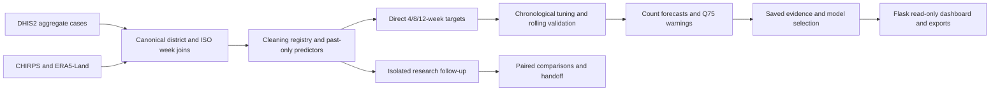

# Research and dashboard handover — 15 October 2026

Start with `research_extensions_2026_10/HANDOFF.md` for the generated final research findings and evidence index. The technical corrections and additional analyses are isolated from the submitted thesis results. The dashboard continues to serve its frozen historical 2025W52 issue; it is not a current surveillance deployment.

## Project map



The main services are in `app/services/`; routes and pages are in `app/blueprints/` and `app/templates/`; browser behavior is in `app/static/js/`. Database models are in `app/models/research.py`. The primary assembled input is `data/modelling/modelling_dataset_2020_2025.csv`. The canonical district mapping and six adjudicated errors are in `data/reference/`. Saved main validation summaries are in `data/quality/`, predictions in `data/modelling/`, and final prototype models in `data/models/production/`.

## Corrections

| File | Changed behavior |
|---|---|
| `app/services/models/pooled_tree_validation.py` | Training labels stop at the earliest inner validation origin; classifier threshold history follows that boundary. District metrics use and label the selected operational method. Checkpoint version increased. |
| `app/services/models/sarimax.py` | Internal absent calendar weeks retain missing outcome slots; case outcomes are not interpolated. Count warnings use the threshold margin. Checkpoint version increased. |
| `app/services/model_validation.py` | Average precision groups tied scores. Count scores are distinguished from probabilities for Brier scoring. Empty threshold history raises an explicit error. Reference-year 52/53-week seasonal membership is explicit. |
| `app/services/models/baseline.py` | Warning discrimination uses predicted-minus-threshold consistently. |
| `app/services/explainability.py` | Selection explanations report F2 and its actual value. |
| `app/services/report_data_service.py` | Methods text describes the published count-threshold warning. |
| `app/services/risk_classification.py` | A zero/nonpositive threshold cannot produce a usable ratio-based risk category. |
| `app/services/case_data_cleaning.py`, `modelling_dataset.py` | Interpolation cannot use an anchor from a later feature week. The historical assembled predictors/outcomes were independently rebuilt and found identical. |
| `app/templates/lifecycle/model_evaluation.html`, `dashboard/index.html` | Describes the saved nonseasonal/fallback comparator accurately and identifies the displayed date as an origin-week start, rather than an actual issuance timestamp. |

The calendar membership convention and unavailable-ratio handling include explicit methodological/presentation choices. They are distinguished from the tuning correction in the comparison tables; changed warning labels are not described as improved forecasts.

## What is preserved

`research_extensions_2026_10/baseline/manifest.json` records 240 frozen files, the original Git head/status and the environment. Original datasets, saved summaries and prediction tables remain in place. Production model signatures and all 1,752 stored forecasts are verified separately. Large raw raster files were not recopied; this is a freeze of selected source and modelling evidence, not a complete disk backup.

The working tree already contained deleted `run_wape_model_experiment.py` and `tests/test_wape_model_experiment.py`, plus untracked review/comparison folders before corrections began. These pre-existing changes were not restored or committed. No remote push, paper submission or deployment was performed.

## Run and verify

Use the existing `.venv`, from the repository root. `environment-lock.txt` records the model-run environment; `environment-final-lock.txt` also records the added PDF renderer. Model libraries were not upgraded.

```powershell
.venv/Scripts/python.exe run.py
.venv/Scripts/python.exe -m research_extensions_2026_10.verify_suite
.venv/Scripts/python.exe -m research_extensions_2026_10.run_study core
.venv/Scripts/python.exe -m research_extensions_2026_10.run_sarimax_corrected
.venv/Scripts/python.exe -m research_extensions_2026_10.run_window_workers
.venv/Scripts/python.exe -m research_extensions_2026_10.queue_weekly_climate
.venv/Scripts/python.exe -m research_extensions_2026_10.analyze_study baselines --expanded
.venv/Scripts/python.exe -m research_extensions_2026_10.analyze_study tables
.venv/Scripts/python.exe -m research_extensions_2026_10.build_figures
.venv/Scripts/python.exe -m research_extensions_2026_10.verify_results --require-complete
```

Do not launch overlapping window supervisors. Each horizon worker owns separate checkpoints, and the climate comparator uses a separate prefix. Fits resume only from compatible signatures, parameters and valid outputs. New outputs use temporary files and atomic replacement; the original baseline cannot be overwritten by the freeze script.

`live_http_checks.py` prompts for credentials without echo and verifies a real local server. It makes a live DHIS2 identity request, then tests pages/APIs/exports locally and signs out. It does not extract surveillance. `extract_2026.py` is separate, refuses to overwrite a completed extraction and enforces completed ISO weeks through June. Credentials are not supplied in command arguments, stored in project files, or retained in the Flask login session.

## Interpretation and next ownership

The old 2020–2025 evaluation is development evidence; new analyses on it remain retrospective follow-up. The pre-extraction 2026 protocol fixes the tested models and data boundary. Its weekly evaluation uses frozen surveillance-only models, and its full-climate check has one target week per horizon. No actual prospective issuance or intended-user usability study is established.

All final thesis sentences, structural edits, signatures, poster-template compliance and submission decisions remain with the student/supervisor. The student confirmed formal approvals remain pending and authorized continued local aggregate analysis. This status is recorded accurately; no institutional authorization is fabricated.
